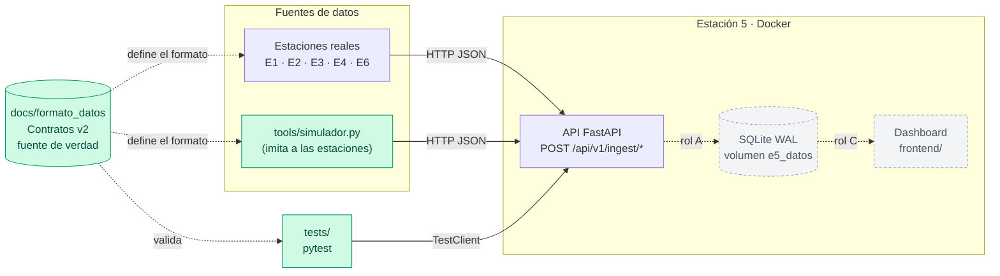
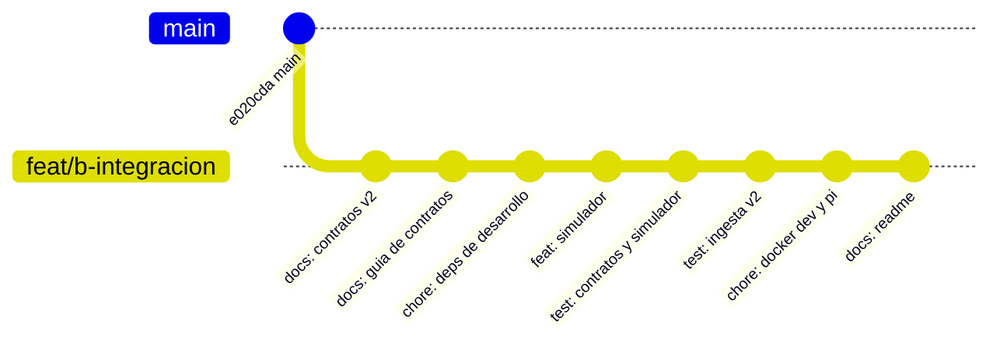
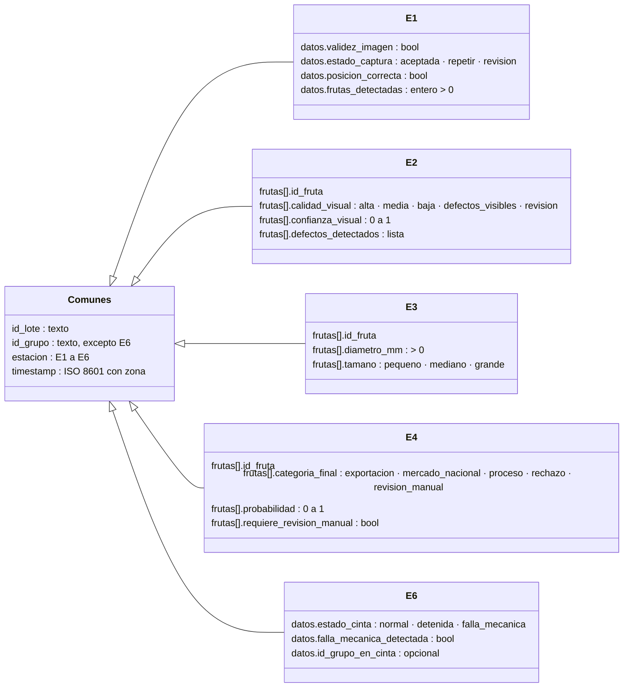
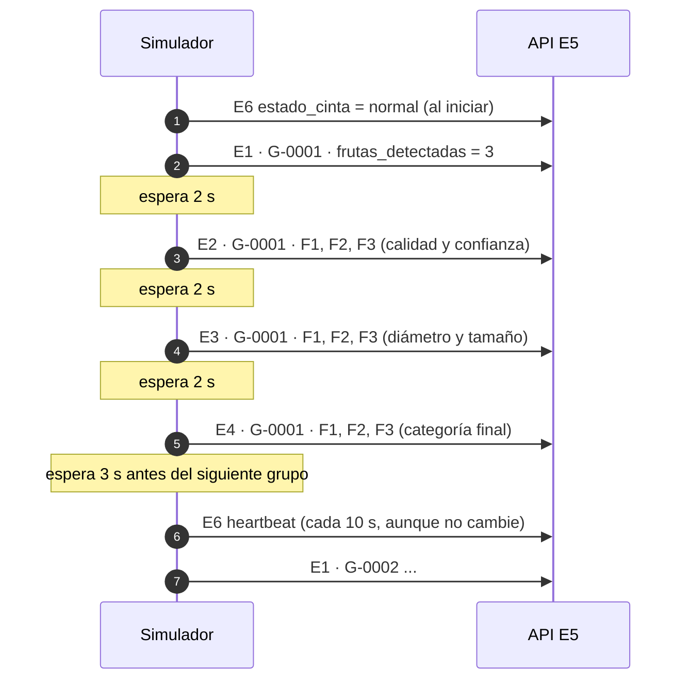
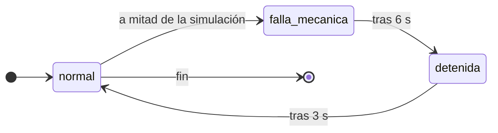
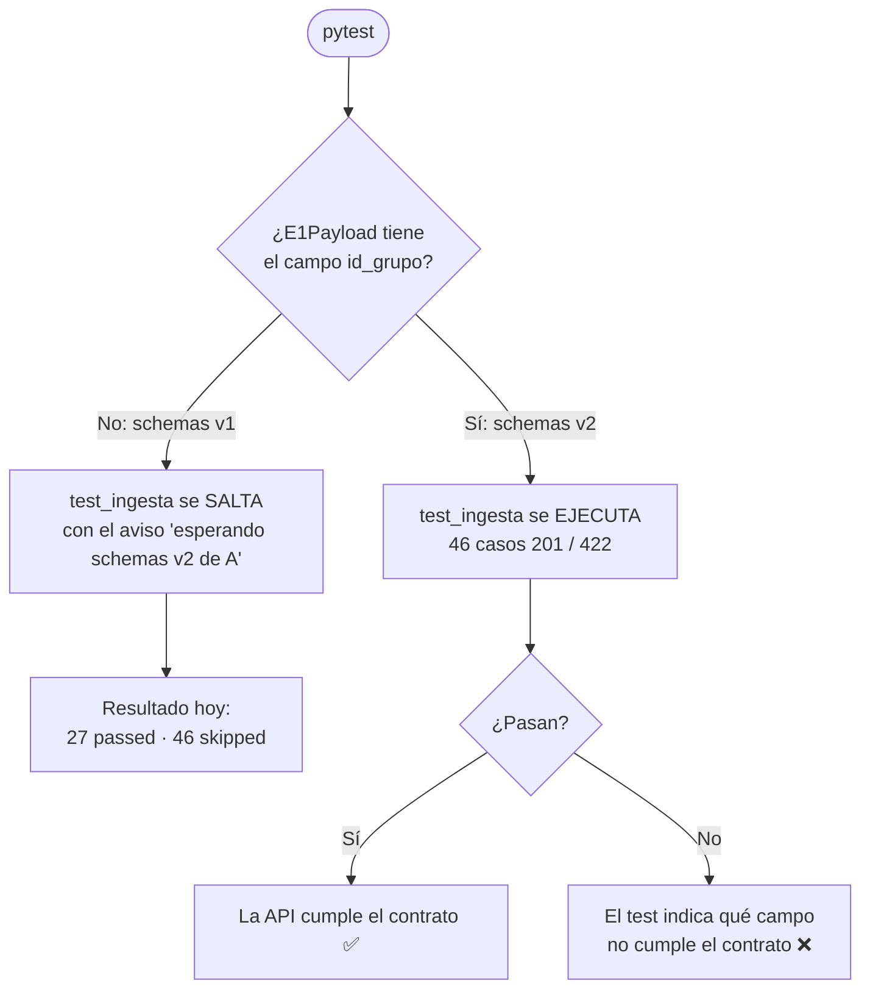
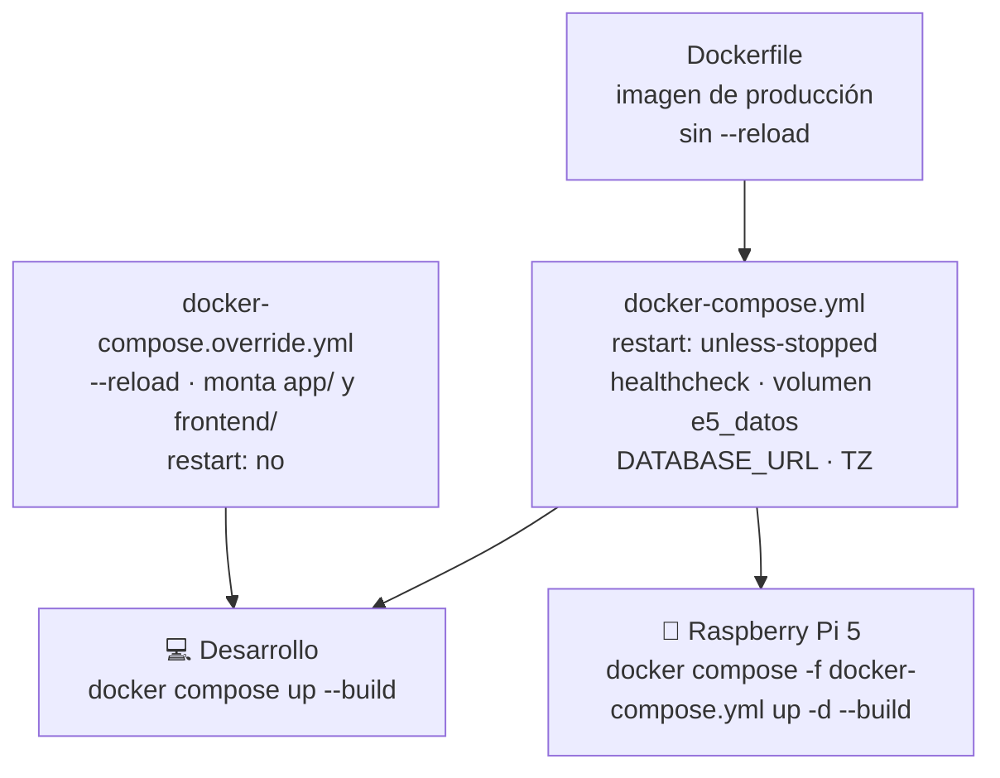
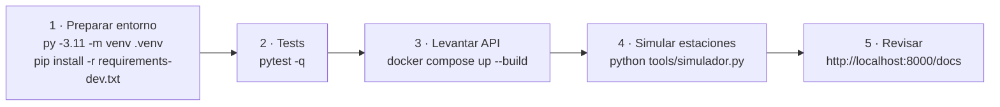

# Rama `feat/b-integracion` — Integración y calidad

**Proyecto:** PackIA · **Estación:** 5 — Supervisión y Trazabilidad
**Rol:** B — Integración y calidad · **Responsable:** Maicol
**Fecha:** 13 de noviembre de 2026 · **Base:** `main` (`e020cda`)

> **Resumen:** esta rama deja a E5 lista para integrarse **sin depender de que las otras estaciones estén listas**. Cierra los contratos de datos v2 (por grupo y por fruta), agrega un **simulador** que imita a E1–E4 y E6, una batería de **tests** que protege los contratos y la API, y deja **Docker** preparado tanto para desarrollo como para la Raspberry Pi 5.

---

## 1. ¿Qué problema resuelve?

Antes de esta rama, E5 tenía una API que validaba mensajes con un formato antiguo (v1, **por caja** y con **carrito**). Las decisiones del equipo cambiaron: ahora se sigue un **grupo de frutas** que viaja en una **cinta transportadora**, y E3 informa **diámetro y tamaño** por fruta.

Para avanzar hacía falta resolver tres bloqueos:

| Bloqueo | Quién estaba esperando | Cómo lo resuelve esta rama |
|---|---|---|
| No había un formato de mensaje acordado (v2) | A (backend), C (dashboard), otras estaciones | Contratos v2 en `docs/formato_datos/` con guía y preguntas abiertas |
| No había datos para probar sin las otras estaciones | A y C | `tools/simulador.py` |
| Nada protegía la API de cambios que rompen los contratos | Todo el equipo | `tests/` con pytest |
| Docker solo servía para desarrollo (`--reload` fijo) | Despliegue en la Pi | Compose base (Pi) + override (desarrollo) |

---

## 2. Vista general

El siguiente diagrama muestra cómo encajan las piezas. En verde, lo que entrega esta rama. En gris, lo que viene después y depende de otros roles.



---

## 3. Historial de la rama

Cada commit es pequeño y se puede revisar por separado.



| # | Commit | Archivos |
|---|---|---|
| 1 | `docs: actualiza contratos de datos a v2 por grupo y fruta` | `docs/formato_datos/E1–E6.json` |
| 2 | `docs: agrega guia de contratos y preguntas para otras estaciones` | `docs/formato_datos/README.md` |
| 3 | `chore: agrega dependencias de desarrollo` | `requirements-dev.txt` |
| 4 | `feat: agrega simulador de estaciones` | `tools/simulador.py` |
| 5 | `test: agrega tests de contratos v2 y simulador` | `tests/conftest.py`, `tests/test_contratos.py` |
| 6 | `test: agrega tests de ingesta v2` | `tests/test_ingesta.py` |
| 7 | `chore: ajusta docker para desarrollo y raspberry pi` | `Dockerfile`, `docker-compose.yml`, `docker-compose.override.yml`, `.env.example`, `.dockerignore` |
| 8 | `docs: documenta tests, simulador y docker en el readme` | `README.md` |

---

## 4. Contratos de datos v2

### 4.1 Qué cambió respecto de v1

| Aspecto | v1 (antes) | v2 (ahora) |
|---|---|---|
| Unidad de seguimiento | Caja (`id_caja`) | Grupo de frutas (`id_grupo`) y fruta (`id_fruta`) |
| E2, E3, E4 | Un objeto `datos` por caja | Una lista `frutas` con un elemento por fruta |
| E1 | Validez, estado y posición | Lo mismo + `frutas_detectadas` |
| E3 | Peso, llenado, consistencia | `diametro_mm` y `tamano` (`pequeno · mediano · grande`) |
| E6 | Carrito: `estado_carrito`, `posicion_actual` | Cinta: `estado_cinta`, `id_grupo_en_cinta` (opcional) |
| `timestamp` | Opcional, lo inventaba E5 | Obligatorio, **con zona horaria**, lo pone la estación |

### 4.2 Forma de los mensajes

Un mensaje **por grupo y por estación**. E1 describe el grupo completo. E2, E3 y E4 traen una fila por fruta. E6 describe la cinta y no depende de un grupo.



Los cinco ejemplos describen **el mismo grupo** (`LOTE-2026-11-A`, `G-0001`, frutas `F1`, `F2` y `F3`). Así se puede seguir una fruta de punta a punta. Por ejemplo, `F1`: calidad alta (E2) → 40 mm, mediano (E3) → exportación (E4).

### 4.3 Preguntas abiertas con las otras estaciones

La guía [`docs/formato_datos/README.md`](../formato_datos/README.md) trae las preguntas pendientes, la **respuesta por defecto** si una estación no contesta y un **mensaje listo para enviar**. Las más importantes:

- ¿E1 asigna `id_grupo` e `id_fruta`? (Por defecto, sí.)
- ¿Qué rangos de diámetro usa E3? (Pendiente. El ejemplo usa 40 mm → mediano.)
- ¿Cada cuánto envía E6? (Por defecto, al cambiar de estado y cada 10 s.)

---

## 5. Simulador de estaciones

### 5.1 Qué hace

`tools/simulador.py` reemplaza a las estaciones reales mientras no estén disponibles. Genera grupos de **2 a 5 frutas** con datos **coherentes entre estaciones**: la categoría de E4 se deriva de la calidad de E2 y el tamaño de E3 se deriva del diámetro.

| Calidad visual (E2) | Categoría final (E4) |
|---|---|
| `alta` | `exportacion` |
| `media` | `mercado_nacional` |
| `baja` | `proceso` |
| `defectos_visibles` | `rechazo` |
| `revision` | `revision_manual` |

E4 marca `requiere_revision_manual = true` si la categoría es `revision_manual` o si la probabilidad es menor que 0,70.

### 5.2 Flujo de un grupo

Así se ve el envío de un grupo a velocidad 1. Con `--velocidad 2`, todos los tiempos se reducen a la mitad.



Cada respuesta se muestra en la consola (`[201] E2 G-0001`). Si la API responde con un error, se muestra el detalle. Al final aparece un resumen: `Mensajes aceptados: N · con error: M`.

### 5.3 Simulación de falla de la cinta

Con `--falla-cinta`, a mitad de la simulación la cinta pasa por estos estados, y cada cambio se envía de inmediato como mensaje E6:



### 5.4 Opciones

| Opción | Para qué sirve | Caso que provoca en E5 |
|---|---|---|
| `--url URL` | Dirección de la API (por defecto `http://localhost:8000`) | — |
| `--grupos N` | Cantidad de grupos; `0` = sin fin (Ctrl+C) | Prueba de carga |
| `--velocidad X` | Multiplica la velocidad (2 = el doble) | Prueba de carga |
| `--semilla N` | Repite exactamente la misma simulación | Reproducir un error |
| `--rangos M,G` | Cortes de diámetro (por defecto `35,45`; `92,112` = prototipo2) | — |
| `--falla-cinta` | La cinta falla y se recupera | Falla crítica E6 |
| `--sin-e3` | E3 no envía nada | Estación sin señal |
| `--baja-confianza` | ~40 % de frutas con confianza < 0,70 | Alerta de E2 y tendencia |
| `--duplicados` | Cada mensaje se envía dos veces | *Upsert* sin duplicar filas |
| `--dry-run` | Solo imprime los JSON, no envía ni espera | Revisar mensajes sin API |

---

## 6. Tests

### 6.1 Qué se prueba

| Archivo | Qué protege | Casos |
|---|---|---|
| `tests/test_contratos.py` | Que los JSON de ejemplo cumplan el contrato v2, que describan el mismo grupo, que 40 mm sea mediano y que el simulador genere mensajes válidos y coherentes (200 grupos por combinación) | 27 |
| `tests/test_ingesta.py` | Que la API responda **201** a cada contrato válido y **422** si falta un campo, un valor está fuera de rango, el `timestamp` no tiene zona o la estación no coincide con la ruta | 46 |

`test_contratos.py` usa un validador propio, escrito a partir del contrato. **No depende de `app/schemas.py`**, así que funciona aunque el backend cambie.

### 6.2 Cómo se activan los tests de ingesta

Los tests de ingesta están escritos para v2, pero `app/schemas.py` todavía está en v1. Para no dejar pytest en rojo mientras el rol A termina su parte, los tests revisan solos en qué versión está la API:



### 6.3 Cómo se verificaron

- **Hoy (schemas v1):** 27 aprobados y 46 saltados.
- **Con schemas v2 de prueba:** se reemplazaron temporalmente `app/schemas.py` y `app/main.py` por una versión v2 mínima que sigue el plan del rol A. Pasaron los **73 tests** y **312 mensajes del simulador** respondieron 201. Después se restauraron los archivos originales.
- **Los tests detectan errores:** se rompieron a propósito dos contratos (un tamaño `chico` y un `id_caja` de v1) y fallaron 5 tests, como corresponde.
- **En un clon limpio:** se clonó la rama en otra carpeta, se creó un entorno nuevo y todo pasó igual.

---

## 7. Docker: desarrollo y Raspberry Pi

### 7.1 Dos modos con los mismos archivos



`docker compose up` suma **automáticamente** el archivo `override`. En la Pi se indica `-f docker-compose.yml` para usar solo la configuración base.

### 7.2 Qué incluye cada pieza

| Elemento | Para qué |
|---|---|
| `restart: unless-stopped` | La API vuelve sola si se cae o si la Pi se reinicia |
| `healthcheck` | Docker revisa `GET /` cada 30 s y marca el contenedor como `healthy` o `unhealthy` |
| Volumen `e5_datos` → `/app/data` | La base SQLite no se pierde al reconstruir o recrear el contenedor |
| `DATABASE_URL` | Por defecto `sqlite:////app/data/e5.db`; PostgreSQL queda como opción |
| `TZ=America/Santiago` | Hora local en los registros del contenedor |
| `.env.example` | Plantilla para cambiar puerto, base de datos o zona horaria |
| `.dockerignore` | Deja fuera `.venv`, `tests`, `tools` y `docs`: imagen más liviana (240 MB) |

### 7.3 Cómo se verificó

| Prueba | Resultado |
|---|---|
| Modo Pi: el contenedor arranca | `healthy`, `restart=unless-stopped`, sin `--reload` |
| Persistencia: escribir en `/app/data`, borrar y recrear el contenedor | El archivo sigue ahí |
| Modo desarrollo: modificar `app/main.py` con el contenedor corriendo | La API se recarga sola y muestra el cambio |
| Simulador contra el contenedor | Se conecta; responde 422 porque la API sigue en v1 (esperado) |
| **En la Raspberry Pi real** | ⏳ **Pendiente** |

---

## 8. Cómo ejecutar todo (guía rápida)



**1. Preparar el entorno** (una sola vez):

```bash
py -3.11 -m venv .venv
.venv\Scripts\activate            # en Linux o macOS: source .venv/bin/activate
pip install -r requirements-dev.txt
```

> Usar Python **3.11**, el mismo de la imagen Docker. Las versiones fijadas de pydantic pueden no instalarse en 3.13.

**2. Ejecutar los tests:**

```bash
pytest -q
# hoy: 27 passed, 46 skipped
```

**3. Levantar la API** (en otra terminal):

```bash
docker compose up --build         # o, sin Docker: uvicorn app.main:app --reload
```

**4. Enviar datos simulados:**

```bash
python tools/simulador.py --dry-run --grupos 2                 # ver los JSON sin enviarlos
python tools/simulador.py --grupos 20 --velocidad 2            # enviar a la API local
python tools/simulador.py --falla-cinta --baja-confianza       # provocar alertas
```

**5. Apagar todo al terminar:**

```bash
docker compose down               # agregar -v borra también la base de datos
```

En Windows, para liberar la RAM de Docker Desktop: cerrar Docker Desktop (*Quit*) y ejecutar `wsl --shutdown`.

---

## 9. Estado y próximos pasos

| Entrega del rol B | Estado |
|---|---|
| Contratos v2 en `docs/formato_datos/` | ✅ Hecho, falta confirmación de las otras estaciones |
| Guía de contratos y preguntas abiertas | ✅ Hecho, falta enviarla |
| `tools/simulador.py` | ✅ Hecho y probado |
| `requirements-dev.txt` | ✅ Hecho |
| Tests de contratos | ✅ 27 aprobados |
| Tests de ingesta (201 / 422) | ✅ Escritos; se activan con los schemas v2 de A |
| Docker para desarrollo y Pi | ✅ Probado en Windows; ⏳ falta en la Pi real |
| Tests de duplicados, desorden y consultas | ⏳ Esperan la persistencia y los `GET` de A |
| Tests de reglas de anomalías | ⏳ Esperan `app/reglas.py` de A |
| Prueba real con E4 y E6 | ⏳ Semana 5 → `docs/integracion/semana5.md` |

### Lo que el equipo tiene que saber

- **Rol A (Gabriel):** los contratos v2 ya están cerrados, así que `schemas.py` v2 puede partir de `docs/formato_datos/`. Cuando lo subas, ejecuta `pytest`: los 46 tests de ingesta se activan solos y te muestran qué falta para cumplir el contrato. Para probar la persistencia sin las otras estaciones, usa el simulador.
- **Rol C (Christian):** el simulador genera los mismos campos que mostrará el dashboard (`tamano`, `estado_cinta`, `categoria_final`). Con `--rangos 92,112` usa los cortes de `prototipo2`.
- **Todos:** cualquier cambio de campo va **primero** al contrato JSON y se avisa en el chat.

### Riesgos abiertos

| Riesgo | Mitigación |
|---|---|
| E3 aún no confirma sus rangos de diámetro | El simulador los recibe como parámetro (`--rangos`); E5 no recalcula el tamaño |
| Las otras estaciones no responden | Se avanza con las respuestas por defecto documentadas |
| Docker no se ha probado en ARM64 | La imagen `python:3.11-slim` tiene versión ARM64; probar en la Pi antes de la semana 6 |
