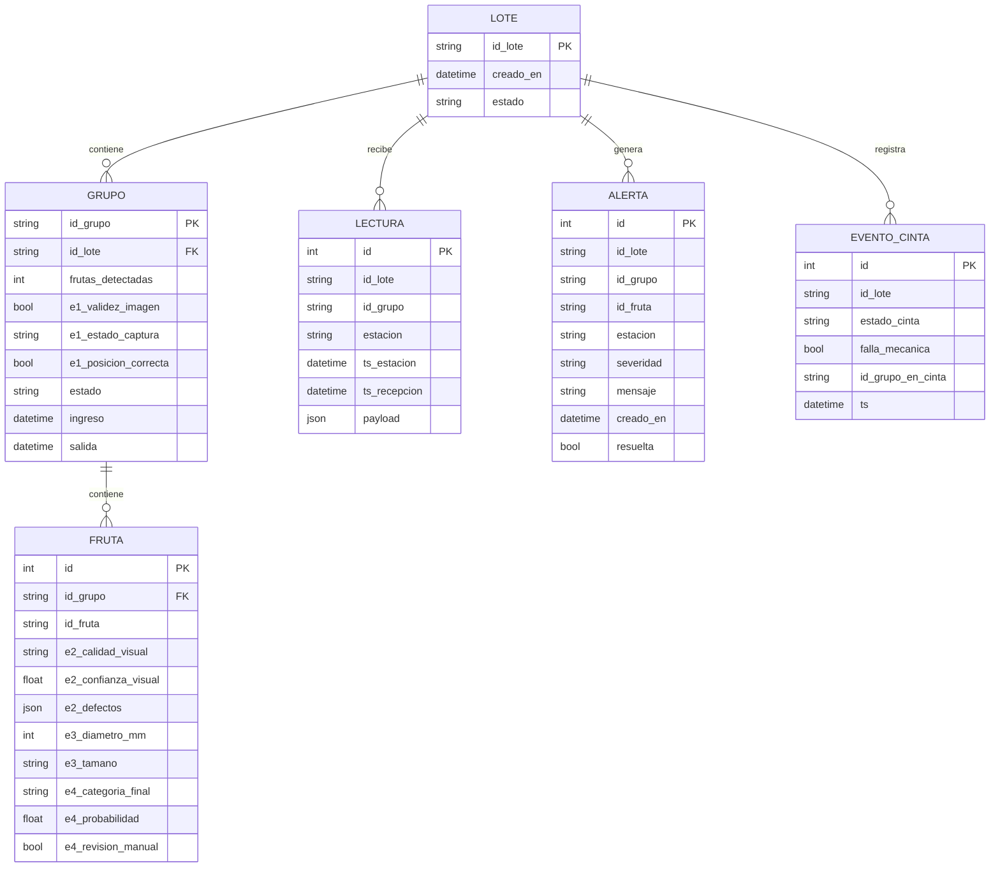

# Plan de avance — Estación 5 (Supervisión y Trazabilidad)

**Proyecto:** PackIA · **Equipo:** Grupo 5 (3 integrantes) · **Desde:** Semana 3 · **Hasta:** Semana 8 (demo final)

> **Objetivo:** pasar de "API que valida" a **trazabilidad persistente por grupo y por fruta**, con un dashboard en vivo conectado al backend real, listo para la demostración final.

---

## 0. Decisiones confirmadas (base de todo el plan)

| Tema | Decisión | Impacto en el código actual |
|---|---|---|
| Transporte | **Cinta transportadora** (no carrito). | E6 cambia `estado_carrito`/`posicion_actual` por `estado_cinta`. |
| Unidad de seguimiento | **Grupo de frutas** dentro de un lote; cada fruta del grupo se identifica individualmente. | `id_caja` se reemplaza por `id_grupo` y se agrega `id_fruta`. |
| Estación 3 | Informa **diámetro (mm) y tamaño** por fruta. Ejemplo: `40 mm → mediano`. | E3 deja de enviar peso, nivel de llenado y consistencia. |

**Regla de oro:** los contratos en `docs/formato_datos/*.json` son la **única fuente de verdad**. Primero se cambia el contrato, después se cambian `schemas.py`, el SQL y el frontend. Ningún cambio de campo entra sin actualizar el contrato en el mismo PR.

---

## 1. Roles del equipo

Cada persona es **dueña** de un área (decide y revisa en ella), pero todos programan en todas.

| Rol | Persona | Es dueño de | Revisa PRs de |
|---|---|---|---|
| **A — Backend y datos** | Gabriel | `app/` (modelos, BD, endpoints de ingesta y consulta) | C |
| **B — Integración y calidad** | Maicol | Contratos JSON, tests, simulador de estaciones, coordinación con E1–E4 y E6, Docker | A |
| **C — Dashboard** | Christian | `frontend/` (pantalla de supervisión, conexión a la API, tiempo real) | B |

> B es además el **punto de contacto** con los otros grupos: acuerda campos, envía ejemplos y agenda las pruebas de integración.

---

## 2. Contratos de datos v2 (propuesta para cerrar en la Semana 3)

**Decisión de diseño:** **un mensaje por grupo y por estación**, con la lista de frutas adentro. Es más simple para las otras estaciones (una llamada HTTP por grupo), es atómico y mantiene el orden.

### Campos comunes

| Campo | Tipo | Obligatorio | Notas |
|---|---|---|---|
| `id_lote` | string | sí | `LOTE-2026-11-A` |
| `id_grupo` | string | sí (excepto E6) | `G-0001` |
| `estacion` | `"E1"`…`"E6"` | sí | Debe coincidir con la ruta; si no, la API responde 422. |
| `timestamp` | datetime ISO 8601 **con zona** | sí | Lo envía la estación, no lo inventa E5. |

### E1 — Recepción y captura (por grupo)
```json
{
  "id_lote": "LOTE-2026-11-A", "id_grupo": "G-0001", "estacion": "E1",
  "timestamp": "2026-11-18T10:15:30Z",
  "datos": {
    "validez_imagen": true,
    "estado_captura": "aceptada",
    "posicion_correcta": true,
    "frutas_detectadas": 3
  }
}
```
`estado_captura` ∈ `aceptada | repetir | revision`

### E2 — Calidad visual (por fruta)
```json
{
  "id_lote": "LOTE-2026-11-A", "id_grupo": "G-0001", "estacion": "E2",
  "timestamp": "2026-11-18T10:16:05Z",
  "frutas": [
    { "id_fruta": "F1", "calidad_visual": "alta",  "confianza_visual": 0.92, "defectos_detectados": [] },
    { "id_fruta": "F2", "calidad_visual": "media", "confianza_visual": 0.81, "defectos_detectados": ["mancha_leve"] }
  ]
}
```
`calidad_visual` ∈ `alta | media | baja | defectos_visibles | revision`

### E3 — Diámetro y tamaño (por fruta)
```json
{
  "id_lote": "LOTE-2026-11-A", "id_grupo": "G-0001", "estacion": "E3",
  "timestamp": "2026-11-18T10:16:40Z",
  "frutas": [
    { "id_fruta": "F1", "diametro_mm": 40, "tamano": "mediano" },
    { "id_fruta": "F2", "diametro_mm": 47, "tamano": "grande" }
  ]
}
```
`tamano` ∈ `pequeno | mediano | grande` · `diametro_mm` > 0

> **E3 calcula el tamaño.** E5 guarda el diámetro y el tamaño tal como llegan, y **no** aplica sus propios cortes. Así, si E3 ajusta sus rangos, no hay que tocar el backend.

### E4 — Decisión comercial (por fruta)
```json
{
  "id_lote": "LOTE-2026-11-A", "id_grupo": "G-0001", "estacion": "E4",
  "timestamp": "2026-11-18T10:17:10Z",
  "frutas": [
    { "id_fruta": "F1", "categoria_final": "exportacion", "probabilidad": 0.88, "requiere_revision_manual": false }
  ]
}
```
`categoria_final` ∈ `exportacion | mercado_nacional | proceso | rechazo | revision_manual`

### E6 — Estado de la cinta (no depende de un grupo)
```json
{
  "id_lote": "LOTE-2026-11-A", "estacion": "E6",
  "timestamp": "2026-11-18T10:17:15Z",
  "datos": {
    "estado_cinta": "normal",
    "falla_mecanica_detectada": false,
    "id_grupo_en_cinta": "G-0001"
  }
}
```
`estado_cinta` ∈ `normal | detenida | falla_mecanica` · `id_grupo_en_cinta` es opcional.

### Preguntas que B debe cerrar con las otras estaciones (Semana 3)
- [ ] ¿Quién asigna `id_grupo` y `id_fruta`? (Propuesta: **E1** asigna `id_grupo` y `F1..Fn`, y las demás estaciones los reutilizan.)
- [ ] Rangos de diámetro que usa E3 para pequeño, mediano y grande (solo para mostrarlos en el dashboard y simular datos).
- [ ] Lista cerrada de `defectos_detectados` de E2.
- [ ] ¿Con qué frecuencia envía E6 su estado? (Propuesta: cada vez que cambia y además un *heartbeat* cada 10 s.)
- [ ] URL e IP donde correrá la API de E5 en la red de la planta o la Raspberry Pi.

---

## 3. Modelo de base de datos v2

Se usan dos niveles: un **registro crudo de eventos**, que nunca se pierde, y **tablas consolidadas**, rápidas para el dashboard.



- `LECTURA` guarda **todo** lo que llega tal cual (auditoría y reproceso).
- `FRUTA` tiene restricción única `(id_grupo, id_fruta)`. Si llega una lectura repetida, **se actualiza la fila (*upsert*), no se duplica**.
- Si llega un grupo o lote desconocido, se crea automáticamente. Así el orden de llegada no rompe la ingesta.
- Herramientas: **SQLAlchemy 2.0** y **SQLite** (modo WAL) tanto en desarrollo como en la Raspberry Pi 5 (ver sección 9). PostgreSQL queda como opción mediante `DATABASE_URL`. Alembic es opcional: con `create_all` alcanza hasta la Semana 6.

---

## 4. API objetivo

| Método | Ruta | Para qué | Semana |
|---|---|---|---|
| POST | `/api/v1/ingest/e1` … `/e4`, `/e6` | Ingesta con contratos v2 | 3 |
| GET | `/api/v1/lotes` | Lista de lotes y su estado | 4 |
| GET | `/api/v1/lotes/{id}/grupos?limit=20` | Últimos grupos de un lote | 4 |
| GET | `/api/v1/grupos/{id}` | **Trazabilidad completa** de un grupo con sus frutas y lecturas | 4 |
| GET | `/api/v1/metricas?lote=` | Frutas por hora, % de rechazo, distribución por categoría y tamaño, anomalías por estación | 4 |
| GET | `/api/v1/alertas?activas=true` | Alertas abiertas | 5 |
| PATCH | `/api/v1/alertas/{id}` | Marcar una alerta como resuelta | 5 |
| GET | `/api/v1/estaciones/estado` | Última lectura de cada estación (online o sin señal) | 5 |
| GET | `/api/v1/stream` | **SSE**: eventos en vivo para el dashboard | 6 |
| GET | `/api/v1/reportes/lote/{id}.csv` | Reporte de trazabilidad para la demo | 8 |

### Reglas de anomalías (las aplica E5 al recibir cada mensaje)

| Regla | Severidad |
|---|---|
| E1: `validez_imagen = false` | falla |
| E1: `estado_captura ≠ aceptada` o `posicion_correcta = false` | alerta |
| E1: `frutas_detectadas` ≠ cantidad de frutas informadas por E2, E3 o E4 | alerta |
| E2: `confianza_visual < 0.70` | alerta |
| E2: 3 o más frutas con confianza baja entre las últimas 12 | alerta (tendencia) |
| E3: diferencia de diámetro dentro del grupo mayor que el umbral acordado | alerta (grupo irregular) |
| E4: `categoria_final = rechazo` | falla |
| E4: `requiere_revision_manual = true` | alerta |
| E6: `falla_mecanica_detectada = true` o `estado_cinta = falla_mecanica` | **falla crítica** |
| Una estación no envía datos en más de 30 s con la cinta en marcha | alerta "sin señal" |

Los umbrales van en `app/config.py`, no repartidos por el código.

---

## 5. Plan por semana

Formato: **[A]**, **[B]** y **[C]** indican quién es el dueño. ✅ = criterio de terminado (*definition of done*).

### Semana 3 — Contratos v2 y persistencia
| Quién | Tarea |
|---|---|
| B | Acordar los contratos v2 con E1–E4 y E6 y actualizar `docs/formato_datos/*.json`. Responder las preguntas de la sección 2. |
| A | Reescribir `schemas.py`: `id_grupo`, lista `frutas`, `Literal` en `estacion` y en los valores cerrados, `timestamp` con zona horaria. |
| A | `app/db.py` + `app/models.py` (SQLAlchemy) con las tablas de la sección 3. Las rutas de ingesta guardan una `LECTURA` y hacen *upsert* en `GRUPO` y `FRUTA`. |
| B | `tests/` con pytest + `TestClient`: cada JSON de `docs/formato_datos` responde 201, y los casos inválidos responden 422. Usar una BD SQLite en memoria. |
| B | `tools/simulador.py`: envía grupos completos (E1→E2→E3→E4 y E6) a la API con datos aleatorios realistas. **Es clave para avanzar sin depender de los otros grupos.** |
| C | Adaptar `prototipo2` a los contratos v2 (`tamano`, `estado_cinta`) y dejar la simulación aislada en `sim.js`, para reemplazarla después por `fetch`. Dejar `frontend/index.html` = último prototipo. |

✅ `simulador.py` corre 5 minutos, la BD tiene grupos y frutas coherentes y `pytest` pasa.

### Semana 4 — Consultas y métricas
| Quién | Tarea |
|---|---|
| A | Endpoints `GET` de lotes, grupos, trazabilidad de un grupo y métricas. |
| A | Activar CORS para el frontend. |
| B | Tests de los endpoints de consulta y de *upsert*/duplicados (enviar dos veces el mismo mensaje no duplica). |
| B | `docker-compose` con PostgreSQL y una variable `DATABASE_URL`. Quitar `--reload` del Dockerfile y usarlo solo en compose de desarrollo. |
| C | El dashboard lee la tabla de últimos grupos y los KPIs desde la API real (*polling* cada 2–5 s). |

✅ Con el simulador encendido, el dashboard muestra datos **reales** de la API.

### Semana 5 — Anomalías, alertas y primera integración
| Quién | Tarea |
|---|---|
| A | `app/reglas.py` con las reglas de la sección 4, tabla `ALERTA` y endpoints de alertas y de estado de estaciones. |
| B | **Prueba de integración real con E4 y E6** (lo dice la hoja de ruta). Registrar las diferencias encontradas en `docs/integracion/semana5.md`. |
| B | Tests unitarios de cada regla de anomalía. |
| C | Panel de alertas, estado online o sin señal por estación y banner de cinta detenida conectados a la API. |

✅ Una falla de E6 enviada por E6 real (o por el simulador) aparece en el dashboard en menos de 5 s.

### Semana 6 — Tiempo real y pulido del dashboard
| Quién | Tarea |
|---|---|
| A | Endpoint SSE `/api/v1/stream` que emite `lectura`, `alerta` y `cinta`. |
| C | Reemplazar el *polling* por `EventSource`, con reconexión automática. |
| C | Vista de **trazabilidad de un grupo**: clic en un grupo → detalle por fruta (E2, E3 y E4) con hora de cada estación. |
| B | Prueba de carga simple: el simulador a 2× la velocidad real durante 30 min, sin errores y con la RAM estable (la API correrá en una Raspberry Pi 5). |

✅ El dashboard se actualiza en vivo sin recargar la página.

### Semana 7 — Pruebas integradas de toda la línea
| Quién | Tarea |
|---|---|
| B | Prueba de punta a punta con **todas** las estaciones: guion de prueba, checklist y registro de resultados. |
| A | Corregir los errores encontrados. Agregar *logging* de los rechazos (422) con el payload, para depurar a otros equipos. |
| C | Ajustes de usabilidad en la pantalla de planta (tamaño de letra, colores de alerta, modo pantalla completa). |
| Todos | Congelar funcionalidades al final de la semana; desde ahí solo se corrigen errores. |

✅ Un lote completo pasa por la línea y su trazabilidad es correcta en la BD y en el dashboard.

### Semana 8 — Demo y cierre
| Quién | Tarea |
|---|---|
| A | Reporte CSV de trazabilidad por lote. |
| B | README final (cómo levantar, contratos y arquitectura) y bitácora de cierre. |
| C | Guion de la demo y presentación. Plan B: si falla una estación real, usar el simulador para ese tramo. |
| Todos | Ensayo general de la demo **dos días antes**. |

---

## 6. Cómo trabajamos

### Ramas y PRs
- `main` siempre funciona. Nadie hace push directo.
- Una rama por tarea: `feat/a-persistencia`, `feat/b-simulador`, `feat/c-api-fetch`, `fix/...`.
- Cada PR es pequeño (idealmente menos de 300 líneas), tiene **1 revisor** según la tabla de roles y debe pasar `pytest`.
- Un cambio de contrato JSON exige avisar en el grupo **antes** de hacer merge.

### Tablero (Trello)
Columnas: `Backlog → Esta semana → En curso → En revisión → Listo`.
Cada tarjeta lleva la letra del dueño ([A], [B] o [C]), la semana y su criterio de terminado. **Máximo 2 tarjetas "En curso" por persona.**

### Reuniones
| Qué | Cuándo | Duración |
|---|---|---|
| Daily por chat: ayer, hoy, bloqueos | Todos los días, antes de las 10:00 | 3 líneas |
| Planificación de la semana: mover tarjetas y repartir | Lunes | 20 min |
| Demo interna y bitácora: mostrar lo que funciona y escribir `docs/trelo/semanaN.md` | Viernes | 30 min |

### Definición de terminado (aplica a toda tarea)
- [ ] Funciona en `docker compose up` de un compañero, no solo en mi PC.
- [ ] Tiene un test, o una prueba manual descrita en el PR.
- [ ] Si toca contratos o endpoints: README o `docs/` actualizados.

---

## 7. Riesgos y cómo los cubrimos

| Riesgo | Mitigación |
|---|---|
| Otras estaciones no están listas para integrar | Usar `tools/simulador.py` para que E5 avance sola; la integración real se hace en las semanas 5 y 7. |
| Cambian campos a última hora | Contratos versionados en `docs/formato_datos`; la API rechaza con 422 un mensaje claro y queda en el log. |
| Mensajes duplicados o fuera de orden | Hacer *upsert* por `(id_grupo, id_fruta)`, crear grupos y lotes automáticamente y guardar el `timestamp` de la estación. |
| La Raspberry Pi se queda corta | SQLite o Postgres liviano, prueba de carga en la Semana 6 y SSE en vez de WebSockets. |
| Una persona se atrasa o se enferma | Cada área tiene un revisor que la conoce (tabla de roles) y puede tomar la tarea. |

---

## 8. Checklist inmediato (esta semana)

- [x] **Todos:** roles asignados: A = Gabriel, B = Maicol, C = Christian.
- [ ] **B:** enviar la sección 2 a los grupos E1–E4 y E6 y cerrar las preguntas abiertas.
- [ ] **A:** crear la rama `feat/a-contratos-v2` con los nuevos `schemas.py`.
- [ ] **B:** crear la rama `feat/b-simulador`.
- [ ] **C:** crear la rama `feat/c-prototipo-v2-contratos`.
- [ ] **Todos:** crear las tarjetas de la Semana 3 en Trello a partir de la tabla de la sección 5.

---

## 9. Despliegue en Raspberry Pi 5 (con monitor)

La Pi 5 es el equipo de E5: corre la API y la base de datos, y muestra el dashboard en un **monitor conectado por HDMI** en modo kiosko (Chromium a pantalla completa, sin barras ni pestañas).

| Tema | Decisión |
|---|---|
| Sistema | Raspberry Pi OS de **64 bits** (la imagen `python:3.11-slim` y las dependencias tienen versión ARM64). |
| Base de datos | **SQLite en modo WAL** en un volumen persistente (menos RAM que PostgreSQL). Preferir SSD; con tarjeta SD, hacer respaldos periódicos. |
| Arranque | `restart: unless-stopped` en `docker-compose.yml` y Docker habilitado al inicio. Sin `--reload` en producción. |
| Dashboard | La API sirve `frontend/` (`StaticFiles`) y Chromium abre `http://localhost:8000/` en kiosko al encender la Pi. |
| Red | IP fija para la Pi; las otras estaciones y el parámetro `?api=` usan esa IP. |
| Hora | NTP activo; si la Pi arranca sin red, la hora de recepción sirve de respaldo al `timestamp` de la estación. |
| Monitoreo | Endpoint con temperatura, CPU y RAM **reales** (`psutil`) para el panel de la Pi, y `healthcheck` en el compose. |

| Quién | Tarea | Cuándo |
|---|---|---|
| Maicol (B) | Compose con `restart`, volumen de la BD, sin `--reload`, `healthcheck`; probar `docker compose up` **en la Pi**; configurar NTP e IP fija. | Día 4–5 |
| Gabriel (A) | SQLite con WAL por defecto; `StaticFiles` para servir el frontend; endpoint `GET /api/v1/sistema` con métricas reales de la Pi. | Día 3–4 |
| Christian (C) | Script de kiosko (`chromium-browser --kiosk --noerrdialogs --disable-infobars http://localhost:8000/`) con arranque automático; panel de la Pi con datos reales; probar tamaños en el monitor real. | Día 4–5 |

**Probar en la Pi real antes de la Semana 6**, no dejarlo para la demo.
