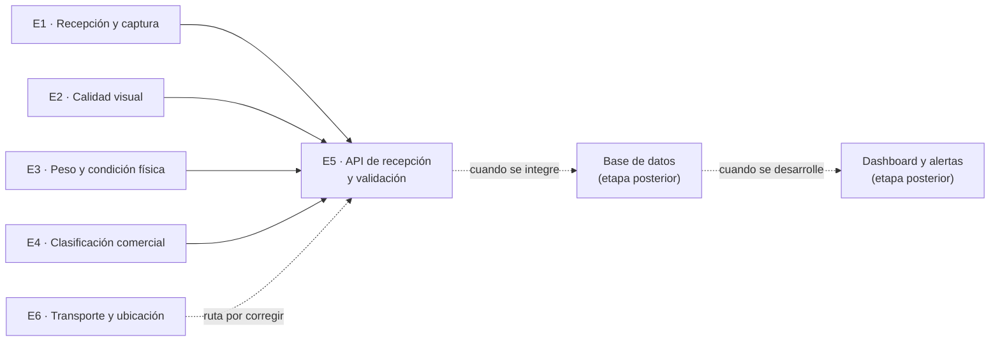
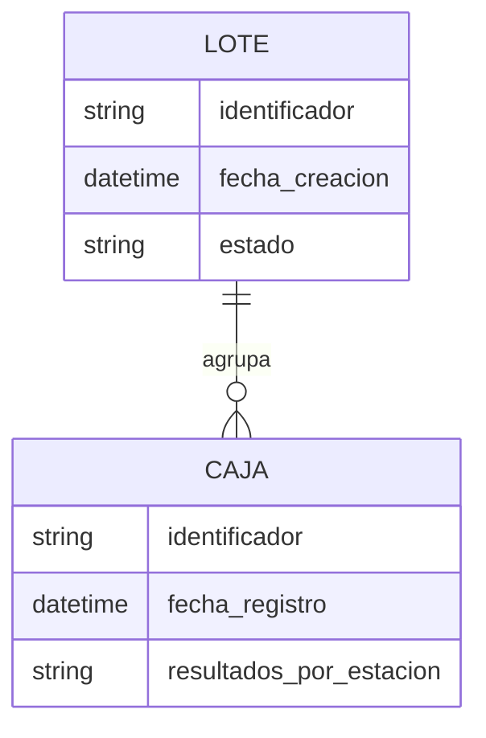

# Bitácora de desarrollo — Semana 2

**Proyecto:** PackIA
**Estación:** 5 — Supervisión y Trazabilidad
**Equipo responsable:** Grupo 5 (3 integrantes)
**Enfoque de la semana:** definir cómo se comunican las estaciones y dejar preparada una primera API de recepción.

> **Resumen ejecutivo:** durante esta semana se acordó qué información debe entregar cada estación y se preparó una API que recibe y valida los mensajes de E1 a E4. El modelo de datos de E6 está definido, pero su ruta requiere corrección antes de integrarla. También se dejó un esquema inicial para organizar lotes y cajas. La API todavía no guarda la información en una base de datos ni ofrece un dashboard: esas capacidades forman parte de las siguientes etapas.

## 1. ¿Qué hace la Estación 5?

PackIA acompaña el recorrido de una caja de papayas por varias estaciones. La Estación 5 cumple el papel de **centro de supervisión**: recibe los resultados de las estaciones, los relaciona con su caja y lote y, en etapas posteriores, permitirá consultar la trazabilidad y detectar situaciones que requieran atención.

La unidad de seguimiento acordada es **la caja completa dentro de un lote**, no cada papaya como un registro independiente.

### Recorrido de la información

**Lectura del diagrama:** las estaciones envían datos a la API de E5. Hoy la API puede recibirlos y validarlos; las líneas punteadas representan componentes planificados, no capacidades ya conectadas.

## 2. Acuerdos de interfaz entre estaciones

Cada registro identifica **qué lote** y **qué caja** se está informando, además de indicar el momento de la lectura. A esos datos comunes se agregan los resultados propios de cada estación.

| Estación | Información que aporta | ¿Para qué sirve en la trazabilidad? |
|---|---|---|
| **E1 — Recepción y captura** | Validez de la imagen, estado de captura y posición de la caja. | Confirma que la caja pudo ser identificada y capturada correctamente. |
| **E2 — Calidad visual** | Evaluación visual, nivel de confianza y defectos observados. | Deja constancia de la condición externa detectada. |
| **E3 — Evaluación física** | Peso total, nivel de llenado, cantidad visible de frutas y consistencia física. | Aporta medidas físicas asociadas a la caja. |
| **E4 — Clasificación comercial** | Categoría propuesta, probabilidad de clasificación y necesidad de revisión manual. | Registra el resultado comercial y si requiere atención de una persona. |
| **E6 — Transporte y logística** | Estado del carrito, posición y detección de una posible falla mecánica. | Permite relacionar el avance del producto con su ubicación y transporte. |

Los datos se intercambian como mensajes estructurados (JSON) a través de una API HTTP. Los esquemas definidos con Pydantic verifican que los campos esperados estén presentes y tengan un formato admisible antes de aceptar cada solicitud.

### Ejemplo ilustrativo de una caja

El siguiente recorrido es **un ejemplo para explicar el flujo**, no un resultado de producción:

| Momento del recorrido | Ejemplo de información |
|---|---|
| Identificación | Lote `LOTE-2026-10-A`, caja `CAJA-0047` |
| E1 | Captura válida y posición correcta |
| E2 | Calidad visual alta; confianza de 0,92; se observa una mancha leve |
| E3 | Peso de 4,85 kg; llenado adecuado; 8 frutas visibles |
| E4 | Categoría de exportación; probabilidad de 0,88 |
| E6 | Carrito en estado normal, con ubicación informada por la estación |

Al compartir los mismos identificadores de lote y caja, los resultados de distintas estaciones pueden asociarse al mismo recorrido. La persistencia conjunta de esos resultados todavía debe integrarse.

## 3. Ficha de interfaz de la Estación 5

| Aspecto | Definición acordada |
|---|---|
| **Propósito** | Recibir y validar información de las estaciones para apoyar la supervisión y la trazabilidad de cajas y lotes. |
| **Entradas** | Mensajes estructurados de E1, E2, E3, E4 y E6, identificados por lote, caja y fecha/hora. |
| **Proceso de esta etapa** | Validación del formato de los mensajes y respuesta de recepción desde la API. |
| **Salidas previstas** | Respuesta de la API; más adelante, consultas de trazabilidad, indicadores y avisos en un dashboard. |
| **Usuarios beneficiados** | Equipo de integración, administrador y jefe de planta. E6 también podría recibir avisos operacionales en una etapa posterior. |
| **Errores a considerar** | Mensaje incompleto o inválido, identificador de lote/caja ausente, problemas de conexión o lecturas fuera de secuencia. |
| **Tratamiento propuesto** | Informar el rechazo de datos inválidos, registrar incidentes y diseñar mecanismos de reintento y aviso operativo. Estos mecanismos aún no están implementados. |

## 4. Avances realizados y estado actual

| Área | Avance de la semana | Estado al cierre de esta bitácora |
|---|---|---|
| **Ficha de interfaz** | Se formalizaron entradas, procesamiento, salidas, errores y respuestas esperadas. | Definición acordada para orientar la integración. |
| **Contratos de datos** | Se describieron los campos de E1, E2, E3, E4 y E6; los modelos de validación están definidos. | Preparados en la API para recibir y revisar la estructura de los mensajes. |
| **API de recepción** | Se creó el servicio con FastAPI y se definieron rutas de ingesta para las estaciones. | El servicio responde y valida los mensajes de E1 a E4; debe corregirse y probarse la ruta de E6. La recepción aún no equivale a guardar el dato. |
| **Documentación de la API** | FastAPI genera documentación interactiva a partir de las rutas y modelos. | Disponible al ejecutar el servicio localmente; su publicación y prueba conjunta con las otras estaciones deben confirmarse. |
| **Modelo de información** | Se propuso la relación entre lotes y cajas y se creó un esquema SQL inicial. | Es una base de diseño; todavía no está conectada a la API ni a una base de datos operativa. |
| **Contenedores** | Se prepararon Dockerfile y Docker Compose para levantar el servicio. | Entorno de ejecución local preparado. |
| **Dashboard, métricas y alertas** | Se definieron como parte de la arquitectura objetivo. | Pendientes; no forman parte del servicio disponible actualmente. |

### Precisión importante sobre el alcance

La API **no persiste todavía** las lecturas en PostgreSQL o SQLite. Tampoco están implementados el cálculo de métricas acumuladas, la detección de anomalías, el búfer de reintentos, los avisos en tiempo real ni un dashboard. Son objetivos de trabajo posteriores, no resultados completados en la Semana 2.

La documentación del servicio declara rutas para E1, E2, E3, E4 y E6. En la revisión del backend se detectó que la ruta asignada al manejador de E6 está duplicada con la de E4; por ello, la ruta de E6 debe corregirse y probarse antes de dar por validada la integración de esa estación.

## 5. Arquitectura y decisiones técnicas

La solución se plantea por capas para separar la recepción de datos, su almacenamiento y su presentación:

1. **Estaciones de origen:** producen observaciones sobre la caja o su transporte.
2. **API de E5:** recibe mensajes HTTP y verifica su estructura.
3. **Persistencia relacional:** guardará lotes y sus cajas cuando se conecte la base de datos.
4. **Análisis y presentación:** permitirá consultar indicadores y, posteriormente, visualizar avisos.

| Componente | Tecnología considerada | Situación |
|---|---|---|
| API y documentación | Python, FastAPI y OpenAPI/Swagger | API base implementada. |
| Validación de datos | Pydantic | Modelos de las estaciones definidos. |
| Ejecución reproducible | Docker y Docker Compose | Configuración preparada para desarrollo local. |
| Almacenamiento | PostgreSQL o SQLite | Esquema inicial diseñado; falta conectar y probar una base de datos. |
| Acceso a datos y cambios de esquema | SQLAlchemy y Alembic | Alternativas consideradas; no aparecen integradas en la API actual. |
| Actualización del dashboard | WebSockets o SSE | Propuesta para una fase futura. |
| Interfaz y análisis | React, TailwindCSS y herramientas de análisis | Propuesta; fuera del alcance implementado esta semana. |

### Modelo conceptual de información

Un lote puede agrupar varias cajas; cada caja se asocia a un lote. El esquema inicial representa esta relación, pero debe completarse para cubrir todos los datos de los contratos de estación y conectarse al servicio antes de considerarlo almacenamiento operativo.

## 6. Riesgos y decisiones pendientes

| Riesgo o pendiente | Efecto posible | Próximo paso |
|---|---|---|
| No existe persistencia conectada. | Los datos recibidos no quedan disponibles como historial después de la respuesta de la API. | Integrar la base de datos y probar el almacenamiento por lote y caja. |
| La ruta de E6 está duplicada con E4. | La estación de transporte no dispone de una ruta de ingesta diferenciada y verificable. | Corregir la ruta y validar la documentación automática de la API. |
| El esquema SQL no cubre todos los campos de los mensajes. | Parte de la información de estación podría no quedar representada al persistirla. | Alinear el modelo de datos con los contratos acordados. |
| Aún no hay pruebas de integración entre estaciones. | Pueden aparecer diferencias de nombres, formatos o secuencia al conectar los equipos. | Acordar ejemplos compartidos y realizar pruebas de extremo a extremo. |
| Los mecanismos de reintento y alertas son una propuesta. | Una desconexión podría interrumpir el flujo sin recuperación automática. | Definir e implementar la estrategia de registro, reintento y notificación. |

## 7. Hoja de ruta del proyecto

La bitácora de referencia organiza el trabajo en ocho semanas. La planificación siguiente distingue lo que se propone para cada etapa; no implica que las semanas futuras ya estén completadas.

| Semana | Hito | Estado respecto de esta bitácora |
|---|---|---|
| **1** | Levantamiento de requisitos, arquitectura inicial y flujo por cajas. | Etapa previa. |
| **2** | Ficha de interfaz, contratos de datos, API base y contenedores. | **Avance documentado en esta bitácora.** |
| **3** | Conexión a base de datos, persistencia transaccional y métricas por lote. | Pendiente / siguiente etapa. |
| **4** | Reglas de anomalías, manejo de fallos y registro de incidentes. | Planificado. |
| **5** | Integración parcial con E4 y E6 y prueba de trazabilidad. | Planificado. |
| **6** | Dashboard, indicadores, alertas y comunicación en tiempo real. | Planificado. |
| **7** | Pruebas integradas del flujo entre estaciones. | Planificado. |
| **8** | Demostración final, reportes de trazabilidad y cierre. | Planificado. |

## 8. Mensaje clave para el equipo y la jefatura

**La Semana 2 dejó definido el contrato de comunicación y una primera puerta de entrada para la información de las estaciones.** El paso siguiente es convertir esa recepción en trazabilidad persistente: conectar la base de datos, completar la correspondencia entre los mensajes y el modelo de almacenamiento, corregir y probar la ruta de E6 y luego avanzar hacia métricas, alertas e interfaz de supervisión.
